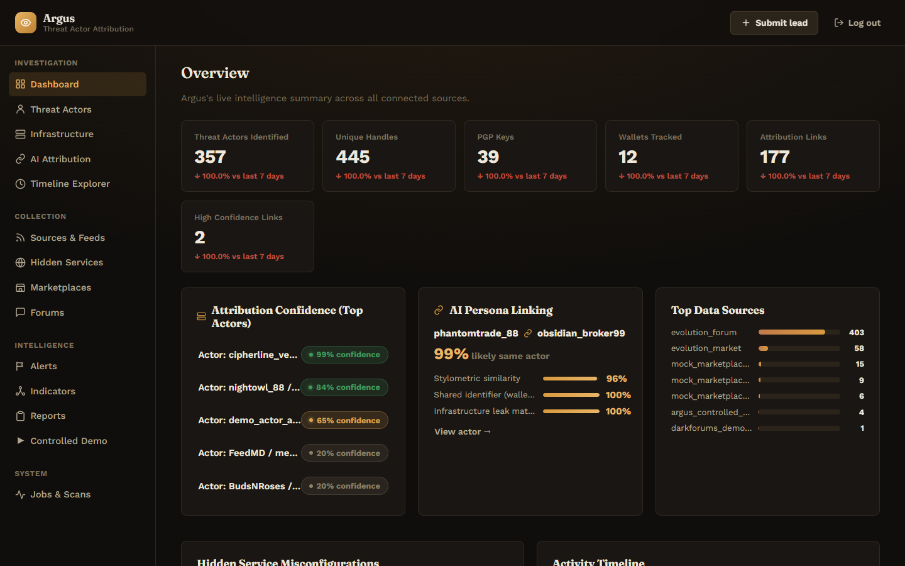
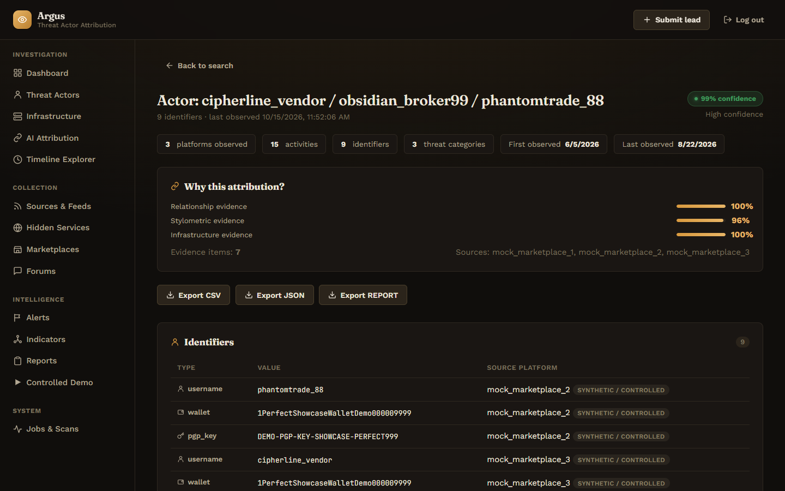
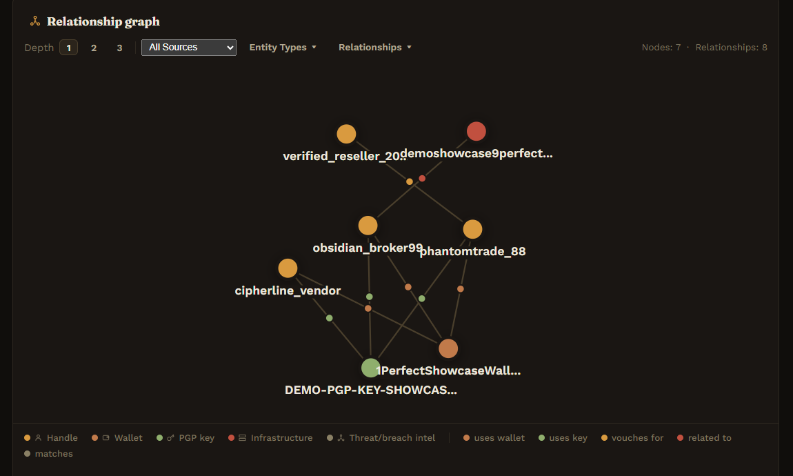
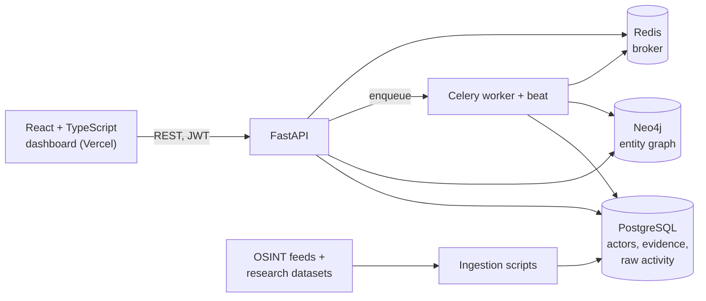

<div align="center">

# Argus

**Dark-web threat actor de-anonymization and attribution.** Argus links pseudonymous personas across platforms using infrastructure fingerprints, a relationship graph and authorship stylometry, and shows the evidence behind every confidence score.

[](https://github.com/rohantiwari9573/SIH-26/actions/workflows/ci.yml)


**[Live dashboard](https://argus-frontend-dun.vercel.app)** · **[API docs](https://argus-api-d6s7.onrender.com/docs)** · **[Architecture](docs/ARCHITECTURE.md)** · **[Ethics](docs/ETHICS.md)**

<sub>Built for Smart India Hackathon 2026, problem statement SIH26151. Registration on the live demo is open. The API runs on a free tier, so the first request after an idle period can take up to a minute.</sub>

</div>

<br />



<table>
<tr>
<td width="50%"><p align="center"><sub>Each actor profile explains <i>why</i> personas were linked, broken down by evidence pillar</sub></p></td>
<td width="50%"><p align="center"><sub>Neo4j relationship graph: handles linked through shared wallets and PGP keys</sub></p></td>
</tr>
</table>

> **Ethics and legal.** Argus never scrapes live dark-web marketplaces. Real intelligence comes only from public OSINT feeds and published academic research datasets. Infrastructure scanning runs only against a self-hosted mock hidden service. See [docs/ETHICS.md](docs/ETHICS.md).

---

## What it does

Argus runs two **independent** analytical pipelines and stores the results in one actor-profile store. A dashboard and REST API sit on top.

**1. Attribution.** *Is this the same actor?*

| Pillar | Module | Approach |
|---|---|---|
| Infrastructure analysis | `app/services/infra_scan` | TLS certificate inspection and banner grabbing to find leaks that tie a hidden service to clearnet infrastructure |
| Relationship mapping | `app/services/graph` | Neo4j entity graph of usernames, PGP keys, wallets and trust links |
| Behavioral stylometry | `app/services/stylometry` | Burrows' Delta authorship attribution, implemented from scratch |
| Wallet clustering | `app/services/wallet_cluster` | Common-input-ownership heuristic |

The pillar scores combine into a weighted confidence score (`app/services/scoring.py`), and every link keeps its evidence and provenance.

**2. Threat categorization.** *What kind of activity is this actor involved in?*

Each piece of real activity (a listing or a post) is classified into a controlled taxonomy such as credential theft, hacking services or stolen data. The source dataset's own category is used when it has one; otherwise conservative keyword rules apply. Categorization **never** feeds the attribution score, so the two answers can't contaminate each other.

## Capabilities

- **Actor search and profiles.** Look up any identifier and see linked personas, infrastructure findings, suspected real-world entities, an activity timeline and the per-pillar attribution evidence.
- **Interactive relationship graph.** The Neo4j-backed graph supports depth, source and entity-type filters.
- **Live lead submission.** Submit a new persona or identifier from the dashboard. A Celery job re-derives every actor cluster from all known data, and the UI polls the job until it finishes.
- **Exports.** Any actor profile exports to CSV, JSON or a PDF report, including the evidence trail.
- **Real intelligence ingestion.** Public OSINT feeds and academic datasets are ingested, and each record is labeled as a historical dataset, live feed or synthetic data.
- **Graded confidence.** A stylometry-only match with no shared identifiers gets partial confidence instead of a yes/no answer. On the demo data, the true pair scores 0.94 against 0.62–0.87 for unrelated pairs.

## Intelligence sources

| Source | Script | Provides |
|---|---|---|
| Evolution Market/Forum dataset (Zenodo) | `ingest_evolution.py` | Historical marketplace listings and forum posts, with ground-truth cross-platform persona matches |
| DarkForums dataset (Zenodo) | `ingest_darkforums.py` | Leak-forum threads and posts with source-provided categories |
| Tor Onionoo (Tor Project) | `ingest_onionoo.py` | Live relay metadata |
| MISP CIRCL + botvrij.eu OSINT feeds | `ingest_misp_osint.py` | Live threat-intel events and indicators |
| Have I Been Pwned breach directory | `ingest_hibp.py` | Public breach metadata |
| URLhaus · MalwareBazaar · Chainabuse | `ingest_urlhaus.py` · `ingest_malwarebazaar.py` · `ingest_chainabuse.py` | Live feeds (each needs an API key) |

`app/services/correlation.py` cross-checks these sources against Argus's own infrastructure findings. The results are used as enrichment evidence only and are never fed into attribution confidence.

## Architecture



The full data flow is in [docs/ARCHITECTURE.md](docs/ARCHITECTURE.md), and the stylometry design is in [docs/AI_STYLOMETRY.md](docs/AI_STYLOMETRY.md).

## Tech stack

| Layer | Technology |
|---|---|
| API | FastAPI, Pydantic, JWT auth |
| Relational store | PostgreSQL, SQLAlchemy, Alembic |
| Graph store | Neo4j |
| Jobs | Celery + Redis (analysis runs asynchronously, never inline on the request) |
| Frontend | React 18, TypeScript, Vite, served as a static build |
| Quality | pytest (~140 tests), Ruff, GitHub Actions |
| Hosting | Vercel · Render · Neon Postgres · Neo4j Aura · Render Key Value |

## Getting started

```bash
git clone https://github.com/rohantiwari9573/SIH-26.git argus
cd argus
cp .env.example .env
docker compose up --build
docker compose exec api alembic upgrade head
```

| Service | URL |
|---|---|
| Dashboard | http://localhost:5173 |
| API + Swagger UI | http://localhost:8000/docs |
| Neo4j browser | http://localhost:7474 |

**Load data and run the pipeline:**

```bash
python scripts/generate_synthetic_dataset.py                 # safe synthetic demo data
docker compose exec api python scripts/ingest_and_attribute.py   # derive attribution from raw, unlinked data
docker compose exec api python scripts/ingest_evolution.py       # optional: real research datasets / OSINT feeds
```

To check the attribution pipeline without a database, run `PYTHONPATH=. python scripts/run_attribution_demo.py`. It prints the clusters and confidence scores to stdout.

To build a production-style static frontend served by nginx, run `docker compose --profile prod up --build frontend-prod`. It serves on port 5174.

## Testing

```bash
docker compose exec api pytest
```

CI runs Ruff and the pytest suite with coverage on every push.

## Deployment

| Component | Host |
|---|---|
| Dashboard | Vercel (static build, `/api/*` rewritten to the API) |
| API + Celery | One Render container. `scripts/render_start.sh` runs uvicorn with a single Celery worker and embedded beat |
| PostgreSQL | Neon |
| Graph | Neo4j Aura |
| Broker | Render Key Value (Redis-compatible) |

## Project layout

```text
app/
  api/routes/   auth, actors, export, leads, jobs, dashboard, health
  services/     attribution pillars, scoring, correlation, threat categorization
  models/       actor.py (derived data) · external.py (ingested intelligence)
  workers/      Celery app and analysis tasks
alembic/        database migrations
frontend/       React + TypeScript dashboard
scripts/        dataset generation, pipeline runners, source ingestion
mock_leaky_service/  deliberately misconfigured target for the infra-scan pillar
tests/          unit and integration tests
docs/           architecture, stylometry, ethics
```

## Author

**Rohan Tiwari** · [GitHub](https://github.com/rohantiwari9573) · [LinkedIn](https://www.linkedin.com/in/rohan-tiwari-012106283/)
